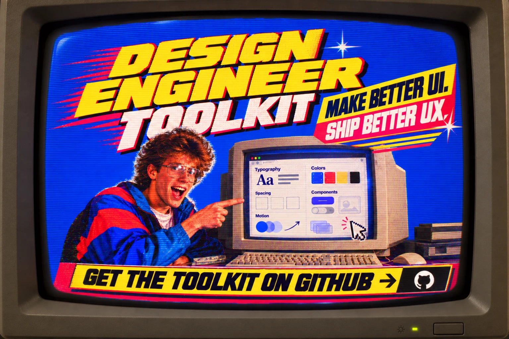

<p align="center">
  
</p>

<h1 align="center">Design Engineer Toolkit</h1>

<p align="center">
  <strong>Make better UI. Ship better UX.</strong><br>
  <code>design-studio</code>, a web design studio run by agents, as a Claude Code plugin.
</p>

<p align="center">
  <a href="https://github.com/MartinMrnn/design-engineer-toolkit/releases"></a>
  <a href="LICENSE"></a>
  <a href="https://docs.claude.com/en/docs/claude-code/plugins"></a>
  
  <a href="https://github.com/MartinMrnn/design-engineer-toolkit/stargazers"></a>
</p>

<p align="center">
  <a href="#install">Install</a> ·
  <a href="#how-it-works">How it works</a> ·
  <a href="#the-steps">The steps</a> ·
  <a href="CHANGELOG.md">Changelog</a>
</p>

---

A web design studio run by agents, for Claude Code. You bring the creative input. A small team of agents (a project lead, a UX designer, an art director, a frontend developer and an independent critic) takes you from a brief to a high-fidelity mockup, one approved step at a time.

**One charter, from the brief to the mockups.** Everything the team decides lives in one place: a native Claude Design System on claude.ai, created at kickoff and enriched at every step. It holds the product (context, intent, story, positioning, voice and wording), the structure (the priority of every page and its copy), the art direction (tokens, components, rules) and the approved mockups and motion. You can browse it, share it and edit it there; the mockup is built from it.

**Design before you code.** Structure, content, art direction, layouts and motion are explored and chosen as lightweight HTML proposals before the final mockup is built.

**The deliverable is a mockup, not a production site.** You get `site/`: a navigable static site in HTML, CSS and JS that looks and moves like the final one. Send it to your client to win the project; if they accept, take it further your own way (content, SEO, the framework you prefer).

## How it works

- **UX first, and the UI serves it.** The UX designer starts from what visitors come for, decides what they need, the path and the mobile plan; the art direction makes that understandable at a glance, with all the character it wants, but never at the expense of the path.
- **Every agent asks its own questions.** Subagents cannot talk to you directly in Claude Code, so the lead relays their questions word for word and passes your answers back.
- **You always get the link.** Every question about a page comes with its preview link, opened in the built-in browser in the desktop app, or to open in your own browser from the CLI.
- **Your decisions carry forward.** The lead never asks again what you decided, and drops everything about the options you did not keep. Every presentation starts with the step you are at, out of nine, and the next one.
- **Ideas before parts.** A direction starts from a governing idea that ties colour, type, composition, the treatment of content and motion together, not from a palette picked on its own. At C1 the art director reads your moodboard as relations and writes four idea cards. At C2 it tests each one as a light specimen in three real situations of your site (the opening, a dense section, an interaction); you keep one or two, which are deepened into comparable sketches of a design system on one contract, side by side on a published board. Then two or three layouts, and two or three motion personalities. You choose, or say "choose for me".
- **Diagnosis at the right level.** When a composition does not work, the studio finds where: the intent, the idea, the palette, the distribution of colour, or the context, with simple tests (a blind reading, grey and blurred views, swapping roles), used to answer a question, never to generate designs.
- **The UX guides, the art direction may enrich.** The UX designer fixes what visitors must understand, do and in what priority, in text; the layout stays open to the art direction, which may propose a change of structure that you approve.
- **An independent critic.** Before you see a proposal, a critic that never saw the maker's reasoning reads it blind, then against its idea, judges the idea and its execution apart, and sends back what falls short with the level at fault.
- **Accessibility is a design constraint, not an art direction.** The WCAG 2.2 criteria the studio requires (levels A and AA) are known from the first exploration; a failing one is solved by another way to carry the idea, never by a silent generic fix. The critic reports accessibility as facts, apart from its scores, and never calls a page compliant.
- **Acceptance criteria at every step.** A step ends when its criteria are met and you approved it.
- **Agents know when to stop.** Turn limits, one self-check, two review rounds at most, then you decide.

## Requirements

- Claude Code signed in to claude.ai (`/login`): the charter, the C2 directions and their board are Artifacts on claude.ai.
- Claude Code (CLI or desktop app).
- The Playwright MCP server, available in every project folder: `claude mcp add --scope user playwright -- npx @playwright/mcp@latest`. Without `--scope user`, it is only added to the folder where you run the command.
- Python 3, for the project kickoff and the local preview server.

## Install

```bash
claude plugin marketplace add MartinMrnn/design-engineer-toolkit
claude plugin install design-studio@design-studio
```

## Start a project

Create an empty folder for the client project, open Claude Code in it, and run `/design-studio:studio` (or `/studio` if no other command uses that name). You can also simply ask for a website mockup.

To resume a project, run the same command in the same folder: the lead reads `design/decisions.md` and continues where you stopped.

## The steps

| Step | Agent | You bring | You get | You approve |
|---|---|---|---|---|
| A1 Kickoff | Lead | The client, goals, pages, deadline, existing site, and any material you already have | The charter, started: context and brief | The brief |
| B1 Product | UX designer | Competitors you know (optional) | Research notes, then intent, story, positioning and wording in the charter | The key messages, then the product sections |
| C1 Moodboard reading and ideas (alongside B1) | Art director, critic | Moodboard, reference sites with what you like in each, counter-examples | The visual intent, read as relations: what we keep, avoid, 5 keywords, the colours seen; then four idea cards | The reading |
| B2 Structure and content | UX designer, critic | Real content to replace `[to provide]` (optional) | Sitemap, the priority of every page and its real copy in the charter; a grey wireframe only where a functional need calls for one | Structure and copy |
| C2 Specimens, then directions | Art directors, critic | Your choices | Four specimens, one per idea, in three real situations; then the one or two you keep, as comparable sketches on one contract, side by side on a shared board; only the kept direction is completed and merged into the charter | One or two specimens, then a direction |
| C3 Key mockups | Art director, critic | Your choices | 2–3 home layouts, then every page and the 404 page, in the charter | One layout per page |
| C4 Motion | Art director, critic | Your choice | 2–3 animated prototypes; the chosen motion in the charter | A motion personality |
| D1 Mockup build | Frontend developer, critic | What must be interactive | `site/`, built from the charter page by page, and any deviation that could not be avoided | Each page type and its deviations |
| E1 Final review | Critic, then frontend developer | Your final remarks | A checked, fixed mockup, ready to send | The final mockup |

## Colour

The art director carries a colour method, `skills/colour/`: colour is chosen from your intent (three words for what the site should make people feel, asked at kickoff), the context and any visual identity you already have, given roles, argued in the charter's "Why these colours", and measured.
- **Three kinds of knowledge**, each claim labelled: a standard (WCAG 2.2, CSS Color 4), an empirical finding (a published study, with its scope), or a design heuristic. A heuristic is a starting point, never a rule.
- **`colour.py`**, a Python 3 script with no dependency: contrast against WCAG 2.2, conversion to OKLCH, lightness ramps, colour-vision-deficiency simulation, the dominant colours of a capture, and a `palette` report on a charter's tokens. It never scores a palette: the contrast pairs the contract requires pass or fail, and the rest informs. `charter.py check` shares its WCAG module.
- **Colour strategies, as a vocabulary.** Colour is also a way of occupying the page: which colour dominates, where, in what proportion, next to what. Each idea decides that distribution, and six colour strategies name the common ones (signal, colour surfaces, flood and tone-on-tone, vivid pair on neutral, primaries on white or black, content carries the colour); none is assigned in advance. How present you want colour (discreet, present, dominant), asked at kickoff, is a preference, or a constraint when you say so. The contract has optional surfaces and tones to paint sections and build tone-on-tone sets.
- **Measures stay information.** `palette` gives the WCAG contrast ratio and ΔL, the difference of OKLCH lightness, as two separate figures: they inform the diagnosis and set no aesthetic threshold.
- **The C2 board** gains a "Colour, measured" row (OKLCH, text contrast, share of the Showcase), headed by your three words.
- **Sources**: every source, its link and its licence is in `skills/colour/references/sources.md`. The method draws on the open `meodai/skill.color-expert` skill (CC BY 4.0), cited there, and no text of it is copied.
- Competitors' colours are not analysed unless you ask.

## What to bring, and when

Bring everything you already have at kickoff, in any form: client information, the existing site, goals, constraints, and also a moodboard, colour ideas, fonts or reference sites. The lead files it in the right place and each agent uses it at its step; the kickoff questions skip what your material already answers. If something is missing when a step needs it (your moodboard before C1, for example), the lead asks for it just before that step.

## Answers that always work

- **"choose for me"**: the agent's recommendation is applied and recorded as such. At C2, an independent art director, who made none of the options, compares them and recommends: the one or two specimens to keep, then the direction.
- **"feedback: …"**: a note on the studio itself (a step, an agent, a skill). It goes to `design/feedback.md`, so you can improve the studio later.

## Your taste file

`~/.claude/design-studio/taste.md` is yours and stays on your machine. On your first project, the lead creates it and offers to fill it with you: a few sites you love and hate, and why. From then on:

- the art director leans on your preferences and avoids your dislikes;
- the critic judges with your eye rather than the model's average taste;
- past directions are listed, so the studio does not repeat itself from one project to the next.

The project's moodboard always leads. When it contradicts your taste file, the studio asks you.

## A project folder

```text
<project>/
  CLAUDE.md                 project facts, links and shared rules, read by every agent
  .claude/launch.json       preview server
  design/
    charter/project/        the charter: README, sections 01–14, tokens, components, cards
    branches/a|b|c/         the three C2 directions
    board/                  their comparison, published on claude.ai
    decisions.md  deviations.md  feedback.md
    inspiration/            your moodboard and references
    ux/                     research notes and captures
    mockups/  motion/       the C3 and C4 options
    reviews/                the critic's reports, captures and check scripts
  site/                     the mockup you send to your client
```

## Using it alongside other skills

Other skills or plugins that react to "build a website", or to any creative work, can take over before the studio does. Turn them off in your studio projects with a `.claude/settings.json` in the project folder, for example:

```json
{
  "enabledPlugins": { "some-plugin@some-marketplace": false },
  "permissions": { "deny": ["Skill(some-skill)"] }
}
```

## Limits of v0.4

- Needs Claude Code signed in to claude.ai. v0.4 does not resume a project started with v0.3; finish it with v0.3. v0.3 does not resume a project started with v0.2; finish it with v0.2.
- Specimens, mockups and motion are shown at 1440 px and 390 px; other widths are checked locally.
- Desktop (1440 px) and mobile (390 px) only, one mockup per project folder.
- The local preview server does not serve `site/404.html` for missing pages; static hosts such as GitHub Pages or Netlify do.
- No production work: frameworks, CMS, SEO, deployment.
- No Figma or other external design tool.
- The critic judges motion from frame sequences and screenshots, not in real time; you judge it in the browser.
- The automated accessibility checks run every axe-core rule tagged WCAG 2.0, 2.1 and 2.2 level A and AA (target size included); a pass covers those rules only and is not WCAG conformance. The critic checks by hand what they cannot see (colour as the only cue, text over images, focus, keyboard), and some criteria are not covered at all (`skills/colour/references/measures.md`). The studio never calls a mockup compliant.
- The automated checks do not see text hidden by masks or clip-path, links to missing pages, or hover and focus states; the critic looks at those itself.

## License

[MIT](LICENSE) © 2026 Martin Morin. You may use, modify and share this plugin, including for client work, as long as the copyright notice and the licence travel with every copy.
