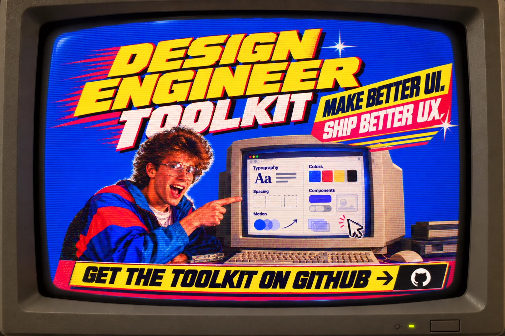

  

<h1 align="center">Design Engineer Toolkit</h1>

  <strong>Make better UI. Ship better UX.</strong> 
  <code>design-studio</code>, a film crew for the web, as a Claude Code plugin.

> **v1 is being rewritten on `main`.** It is not usable yet. For the stable version, use the [v0.3.0 release](https://github.com/MartinMrnn/design-engineer-toolkit/releases/tag/v0.3.0).

You are the director: you bring the vision and the references (moodboard, sites, colours). A crew of expert skills and two neutral agents, a critic and a researcher, turns them into the complete front surface of a web product: a validated mockup first, then the build.

Requires Node, Playwright, git and `gh`.

See [CHANGELOG.md](CHANGELOG.md) and [CREDITS.md](CREDITS.md). MIT licence.
