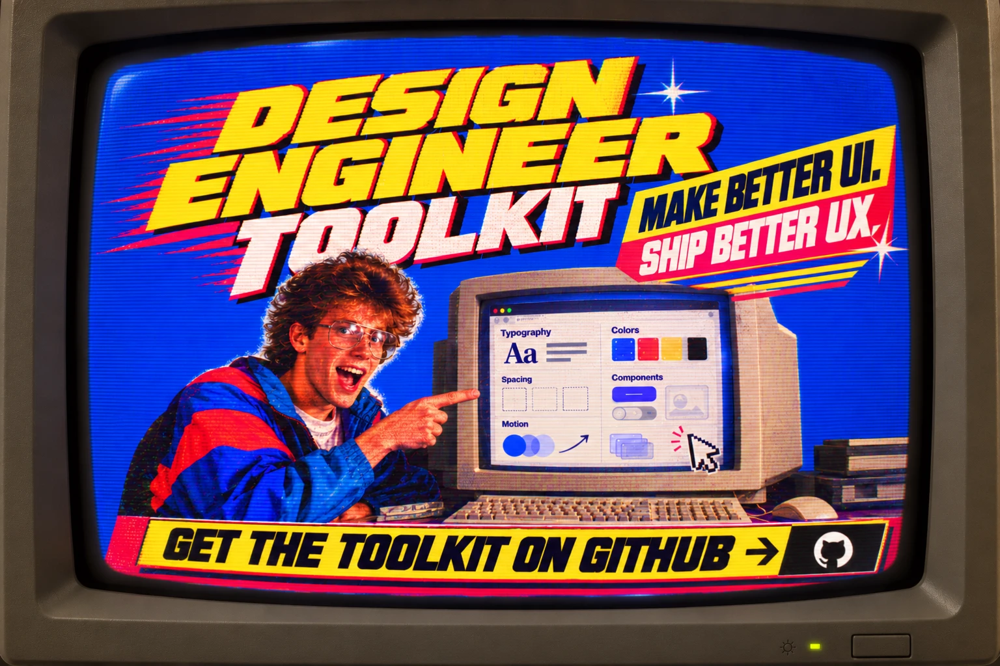

<p align="center">
  
</p>

<h1 align="center">Design Engineer Toolkit</h1>

<p align="center">
  <strong>Make better UI. Ship better UX.</strong><br>
  <code>design-studio</code>, a web design studio run by agents, as a Claude Code plugin.
</p>

<p align="center">
  <a href="https://github.com/MartinMrnn/design-engineer-toolkit/releases"></a>
  <a href="LICENSE"></a>
  <a href="https://docs.claude.com/en/docs/claude-code/plugins"></a>
  
  <a href="https://github.com/MartinMrnn/design-engineer-toolkit/stargazers"></a>
</p>

<p align="center">
  <a href="#install">Install</a> ·
  <a href="#how-it-works">How it works</a> ·
  <a href="#the-steps">The steps</a> ·
  <a href="CHANGELOG.md">Changelog</a>
</p>

---

A web design studio run by agents, for Claude Code. You bring the creative input. A small team of agents (a project lead, a UX designer, an art director, a frontend developer and an independent critic) takes you from a brief to a high-fidelity mockup, one approved step at a time.

**One charter, from the brief to the mockups.** Everything the team decides lives in one place: a native Claude Design System on claude.ai, created at kickoff and enriched at every step. It holds the product (context, intent, story, positioning, voice and wording), the structure and its wireframes, the art direction (tokens, components, rules) and the approved mockups and motion. You can browse it, share it and edit it there; the mockup is built from it.

**Design before you code.** Structure, content, art direction, layouts and motion are explored and chosen as lightweight HTML proposals before the final mockup is built.

**The deliverable is a mockup, not a production site.** You get `site/`: a navigable static site in HTML, CSS and JS that looks and moves like the final one. Send it to your client to win the project; if they accept, take it further your own way (content, SEO, the framework you prefer).

## How it works

- **UX first, and the UI serves it.** The UX designer starts from what visitors come for, decides what they need, the path and the mobile plan; the art direction makes that understandable at a glance, with all the character it wants, but never at the expense of the path.
- **Every agent asks its own questions.** Subagents cannot talk to you directly in Claude Code, so the lead relays their questions word for word and passes your answers back.
- **You always get the link.** Every question about a page comes with its preview link, opened in the built-in browser in the desktop app, or to open in your own browser from the CLI.
- **Your decisions carry forward.** The lead never asks again what you decided, and drops everything about the options you did not keep. The task list shows the nine steps and where you are.
- **Comparable proposals.** At C2, three art directors each build a complete design system on the same contract: the same token names, sections, components and copy. Only the design differs, and a published board compares them row by row. Then two or three layouts, and two or three motion personalities. You choose, mix, or say "choose for me".
- **An independent critic.** Before you see a proposal, a critic that never saw the maker's reasoning scores it on the criteria that apply to the step and sends back what falls short.
- **Acceptance criteria at every step.** A step ends when its criteria are met and you approved it.
- **Agents know when to stop.** Turn limits, one self-check, two review rounds at most, then you decide.

## Requirements

- Claude Code signed in to claude.ai (`/login`): the charter, the C2 directions and their board are Artifacts on claude.ai.
- Claude Code (CLI or desktop app).
- The Playwright MCP server, available in every project folder: `claude mcp add --scope user playwright -- npx @playwright/mcp@latest`. Without `--scope user`, it is only added to the folder where you run the command.
- Python 3, for the project kickoff and the local preview server.

## Install

```bash
claude plugin marketplace add MartinMrnn/design-engineer-toolkit
claude plugin install design-studio@design-studio
```

## Start a project

Create an empty folder for the client project, open Claude Code in it, and run `/design-studio:studio` (or `/studio` if no other command uses that name). You can also simply ask for a website mockup.

To resume a project, run the same command in the same folder: the lead reads `design/decisions.md` and continues where you stopped.

## The steps

| Step | Agent | You bring | You get | You approve |
|---|---|---|---|---|
| A1 Kickoff | Lead | The client, goals, pages, deadline, existing site, and any material you already have | The charter, started: context and brief | The brief |
| B1 Product | UX designer | Competitors you know (optional) | Research notes, then intent, story, positioning and wording in the charter | The key messages, then the product sections |
| B2 Structure and content | UX designer, critic | Real content to replace `[to provide]` (optional) | Sitemap, page structure, real copy and grey wireframes in the charter | Structure and copy |
| C1 Moodboard reading | Art director | Moodboard, reference sites with what you like in each, counter-examples | The visual intent: what we keep, avoid, and 5 keywords | The reading |
| C2 Directions | 3 art directors, critic | Your choice or mix | Three design systems on one contract, side by side on a shared board; the chosen one merged into the charter | A direction |
| C3 Key mockups | Art director, critic | Your choices | 2–3 home layouts, then every page and the 404 page, in the charter | One layout per page |
| C4 Motion | Art director, critic | Your choice | 2–3 animated prototypes; the chosen motion in the charter | A motion personality |
| D1 Mockup build | Frontend developer, critic | What must be interactive | `site/`, built from the charter page by page, and any deviation that could not be avoided | Each page type and its deviations |
| E1 Final review | Critic, then frontend developer | Your final remarks | A checked, fixed mockup, ready to send | The final mockup |

## What to bring, and when

Bring everything you already have at kickoff, in any form: client information, the existing site, goals, constraints, and also a moodboard, colour ideas, fonts or reference sites. The lead files it in the right place and each agent uses it at its step; the kickoff questions skip what your material already answers. If something is missing when a step needs it (your moodboard before C1, for example), the lead asks for it just before that step.

## Answers that always work

- **"choose for me"**: the agent's recommendation is applied and recorded as such. At C2, where three art directors each defend their own direction, a fourth art director, who made none of them, compares the three and recommends one.
- **"feedback: …"**: a note on the studio itself (a step, an agent, a skill). It goes to `design/feedback.md`, so you can improve the studio later.

## Your taste file

`~/.claude/design-studio/taste.md` is yours and stays on your machine. On your first project, the lead creates it and offers to fill it with you: a few sites you love and hate, and why. From then on:

- the art director leans on your preferences and avoids your dislikes;
- the critic judges with your eye rather than the model's average taste;
- past directions are listed, so the studio does not repeat itself from one project to the next.

The project's moodboard always leads. When it contradicts your taste file, the studio asks you.

## A project folder

```text
<project>/
  CLAUDE.md                 project facts, links and shared rules, read by every agent
  .claude/launch.json       preview server
  design/
    charter/project/        the charter: README, sections 01–14, tokens, components, cards
    branches/a|b|c/         the three C2 directions
    board/                  their comparison, published on claude.ai
    decisions.md  deviations.md  feedback.md
    inspiration/            your moodboard and references
    ux/                     research notes and captures
    mockups/  motion/       the C3 and C4 options
    reviews/                the critic's reports, captures and check scripts
  site/                     the mockup you send to your client
```

## Using it alongside other skills

Other skills or plugins that react to "build a website", or to any creative work, can take over before the studio does. Turn them off in your studio projects with a `.claude/settings.json` in the project folder, for example:

```json
{
  "enabledPlugins": { "some-plugin@some-marketplace": false },
  "permissions": { "deny": ["Skill(some-skill)"] }
}
```

## Limits of v0.3

- Needs Claude Code signed in to claude.ai. v0.3 does not resume a project started with v0.2; finish it with v0.2.
- Wireframes, mockups and motion are shown in the charter at 1440 px and 390 px; other widths are checked locally.
- Desktop (1440 px) and mobile (390 px) only, one mockup per project folder.
- The local preview server does not serve `site/404.html` for missing pages; static hosts such as GitHub Pages or Netlify do.
- No production work: frameworks, CMS, SEO, deployment.
- No Figma or other external design tool.
- The critic judges motion from frame sequences and screenshots, not in real time; you judge it in the browser.
- The automated accessibility checks are a baseline (axe-core rules), not an audit.
- The automated checks do not see text hidden by masks or clip-path, contrast over images or gradients, links to missing pages, or hover and focus states; the critic looks at those itself.

## License

[MIT](LICENSE) © 2026 Martin Morin. You may use, modify and share this plugin, including for client work, as long as the copyright notice and the licence travel with every copy.
